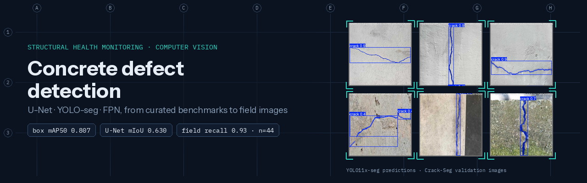
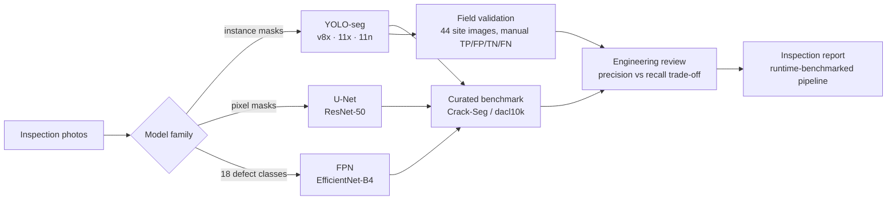
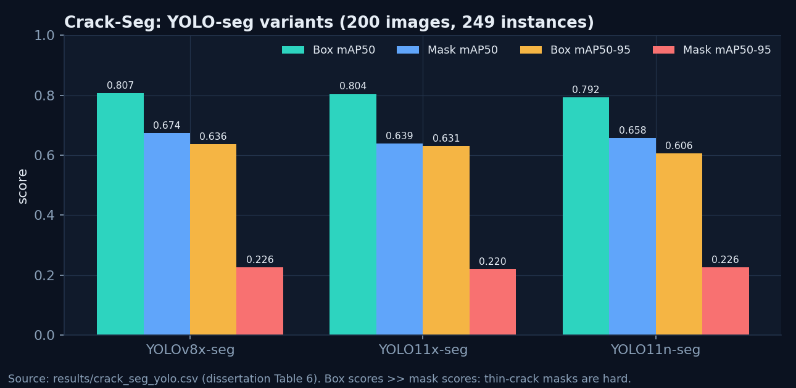
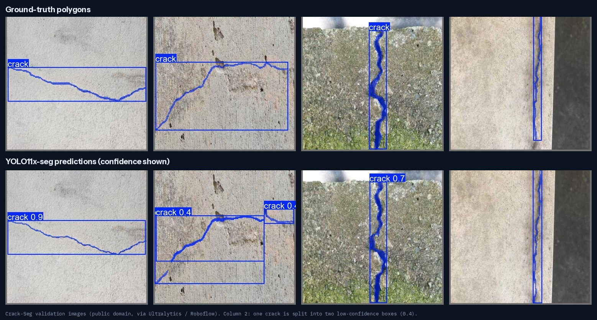
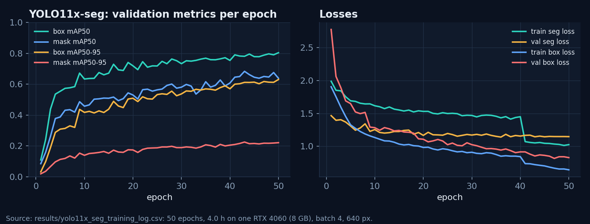
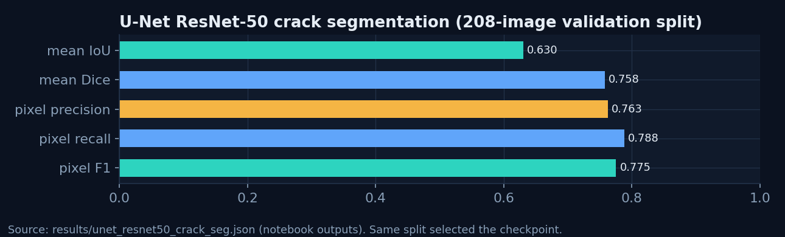
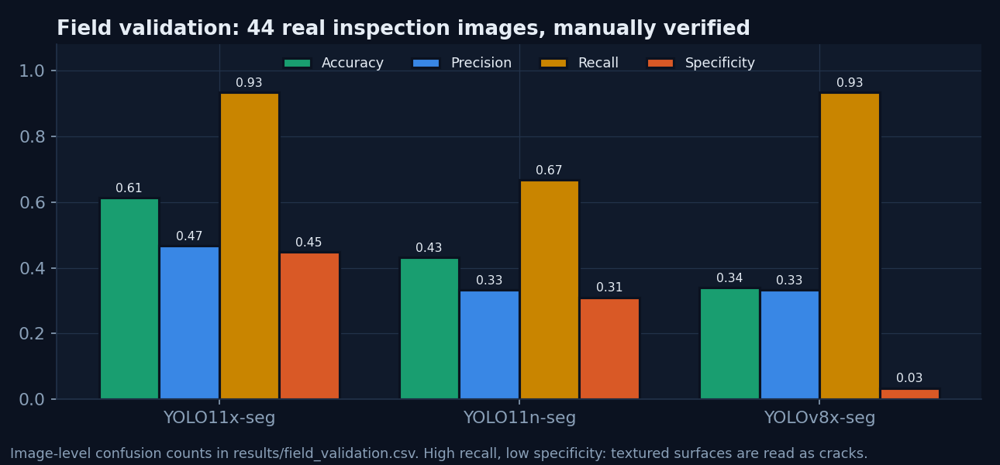
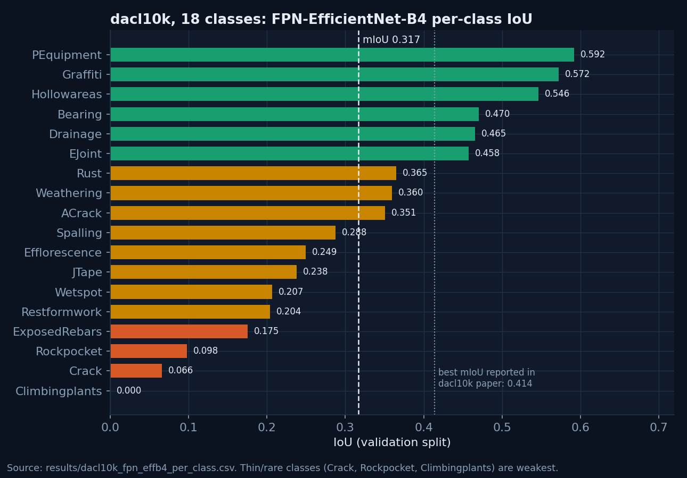
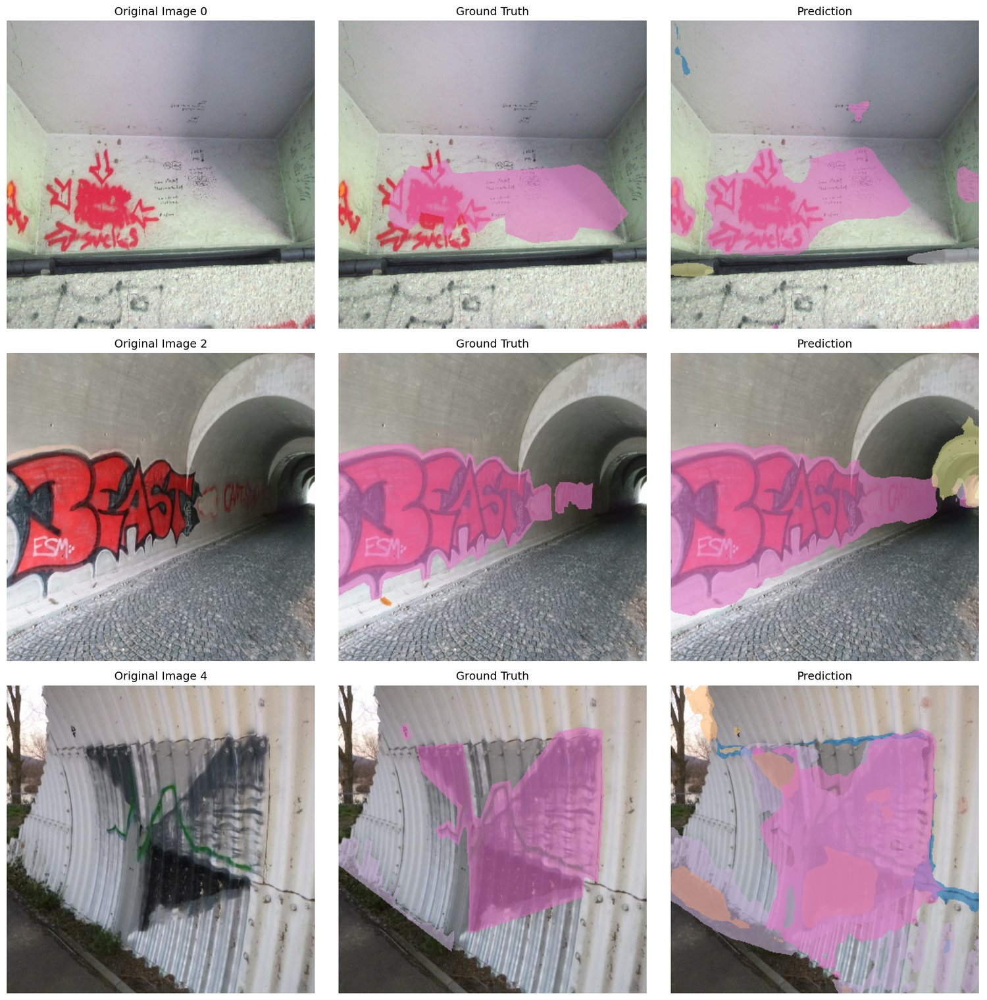

<p align="center"></p>

# Concrete defect detection for structural health monitoring

[](https://github.com/mohamedragab4554/concrete-defect-detection-shm/actions/workflows/ci.yml)


This repository compares three families of deep-learning models for finding concrete defects in inspection photographs. It then tests the best of them on real site images, where curated benchmarks usually overstate performance.

| | |
|---|---|
| **Type** | Academic research: MSc dissertation, Digital Construction Analytics & BIM, Ulster University (MSc awarded with Distinction; dissertation mark 74%) |
| **Author** | Mohamed Ragab (sole author of the models, experiments and code). Supervisor: Prof. Ibrahim Motawa. Field images supplied by an industry partner in Belfast |
| **Status** | Research prototype, **not** a certified inspection tool. The code here is a clean refactor of the original research notebooks, which are kept in [`notebooks/research`](notebooks/research) |

## Results at a glance

| Model | Task | Data | Key result |
|---|---|---|---|
| **YOLOv8x-seg** | Crack instance segmentation | Crack-Seg | box mAP50 **0.807**, mask mAP50 **0.674** |
| **YOLO11x-seg** | Crack instance segmentation | Crack-Seg | box mAP50 0.804, mask mAP50 0.639 |
| **YOLO11x-seg** | Field validation, 44 site images | Industry partner (not shared) | recall **0.933**, accuracy 61.4%, specificity 0.45 |
| **U-Net (ResNet-50)** | Binary crack segmentation | Crack-Seg | mean IoU **0.630**, pixel F1 **0.775** |
| **FPN (EfficientNet-B4)** | 18-class multi-label segmentation | dacl10k | mIoU **0.317** (paper's best reported: 0.414) |

> **Read these numbers with the evaluation notes below.** The Crack-Seg and dacl10k scores are measured on validation splits that were also used for checkpoint selection. The field-validation result is the most honest figure in this repository.

## The engineering problem

Visual inspection of concrete is still mostly manual. It is slow, it varies between inspectors, and it often means working at height or near traffic. The 21 practitioners surveyed for this study (UK, KSA, UAE, Egypt) reported that a medium-sized building takes 4–7 days to inspect. Only 9% had used a computer-vision tool.

The research asks two questions:

1. Which model family (detection-style YOLO-seg, a pixel-level U-Net, or a multi-class FPN) is most useful for crack and defect evidence?
2. How much of benchmark performance survives on real inspection photographs with pipes, cables, coatings and shadows?

## What I did

- Trained and compared **five models**: YOLOv8x-seg, YOLO11x-seg and YOLO11n-seg (Ultralytics); a U-Net with a ResNet-50 encoder; and an FPN with an EfficientNet-B4 encoder for all 18 dacl10k classes.
- Wrote a **stable multi-label trainer** for the heavily imbalanced dacl10k data. It uses a clamped per-class `pos_weight`, BCE + Dice loss, AdamW with warm-up and cosine decay, AMP only after a warm-up, NaN/Inf guards, gradient clipping and early stopping.
- Ran an **external field validation**: 44 real inspection images, with every prediction checked by hand into TP/FP/TN/FN at image level.
- Benchmarked **runtime** for the whole pipeline (Table 8): 689 images processed and reported in 27 min 22 s on one RTX 4060.
- Ran a practitioner survey (n = 21) to ground the requirements.

## Workflow



## Results

### Curated benchmark (Crack-Seg)



The box scores (about 0.80 mAP50) are much higher than the mask scores (0.64–0.67 mAP50, about 0.22 mAP50-95). Cracks are thin, so a mask that is off by a few pixels loses most of its IoU. This is the main reason to add a pixel-level model.







### Field validation: the result that matters most



| Model | TP | FN | TN | FP | Accuracy | Precision | Recall |
|---|---:|---:|---:|---:|---:|---:|---:|
| YOLO11x-seg | 14 | 1 | 13 | 16 | 61.36% | 0.467 | 0.933 |
| YOLO11n-seg | 10 | 5 | 9 | 20 | 43.18% | 0.333 | 0.667 |
| YOLOv8x-seg | 14 | 1 | 1 | 28 | 34.09% | 0.333 | 0.933 |

On the benchmark, YOLOv8x-seg and YOLO11x-seg are almost tied. In the field, **YOLO11x-seg** is the only model that rejects a useful share of non-crack images: specificity 0.45 against 0.03 for YOLOv8x-seg. Both still find 14 of the 15 cracked images.

For inspection triage this is the right failure mode: a missed crack costs more than a false alarm that an engineer dismisses. But 16 false positives out of 29 crack-free images means **a human must review every positive**. Reproduce the table with `python -m shm_defects.field_validation`.

### Multi-class defects (dacl10k, 18 classes)



Large, textured classes do well: protective equipment, graffiti, hollow areas, bearings. Thin or rare classes do poorly: crack 0.066, rock pocket 0.098, climbing plants 0.000. Recall is higher than precision for almost every class (see the CSV), so the model **over-segments**. Raising the per-class thresholds is the obvious next step.



<sub>dacl10k validation images © Flotzinger, Rösch & Braml (2023), CC BY-NC 4.0. Pink = graffiti; other colours = other classes.</sub>

### Runtime (single RTX 4060 8 GB)

| Task | Images | Time / image | Throughput |
|---|---:|---:|---:|
| Crack U-Net | 48 | 0.527 s | ~1.90 img/s |
| Crack-only YOLO | 48 | 0.767 s | ~1.30 img/s |
| Multi-class FPN | 48 | 2.045 s | ~0.49 img/s |
| Full classification + report | 689 | 2.383 s | ~0.42 img/s |

## Evaluation notes and leakage controls

- **Crack-Seg YOLO metrics** use the 200-image split that the dataset YAML names `val`. The dissertation labels it the "test split". Ultralytics also uses that split to choose `best.pt`, so the numbers are best read as validation scores. `train_yolo.py --validate-only --split test` scores the untouched 112-image split.
- **U-Net metrics** come from the 208-image `val` split of the converted dataset. The same split chose the checkpoint (lowest validation Dice loss), so treat 0.630 as optimistic. `evaluate_unet.py --split test` is the correct re-run.
- **dacl10k** mIoU is on the official validation split, also used for checkpoint selection. No separate test evaluation was run.
- **Field images** were never used for training or tuning. They are the only out-of-distribution evidence in this study.

The [model card](MODEL_CARD.md) covers intended use, limits and engineering-use boundaries.

## Repository structure

```
configs/                 YAML configs for every experiment (paths are relative to the repo)
src/shm_defects/
  data.py                YOLO-polygon -> mask dataset; LabelMe JSON -> 18-channel multi-label dataset
  losses.py              soft Dice, BCE + Dice with clamped pos_weight
  metrics.py             IoU / Dice / pixel P-R-F1, multi-label IoU, confusion counts
  models.py              U-Net and FPN factories (segmentation-models-pytorch)
  train_unet.py          U-Net training            evaluate_unet.py   U-Net evaluation
  train_multiclass.py    FPN training on dacl10k   train_yolo.py      Ultralytics wrapper
  field_validation.py    Table 7 from confusion counts
  predict.py             single-image mask + overlay
results/                 metrics exported from the research runs (CSV/JSON), source noted per file
scripts/make_figures.py  rebuilds every chart in docs/images from results/
notebooks/research/      original notebooks with outputs (local paths removed)
tests/                   unit + smoke tests (CPU, no data or weights needed)
```

## Setup

**Windows (PowerShell)**

```powershell
py -3.11 -m venv .venv; .venv\Scripts\Activate.ps1
pip install torch torchvision --index-url https://download.pytorch.org/whl/cu121   # or /whl/cpu
pip install -e ".[yolo,dev]"
```

**macOS / Linux**

```bash
python3.11 -m venv .venv && source .venv/bin/activate
pip install torch torchvision            # CPU/MPS build on macOS; add the CUDA index URL on Linux GPUs
pip install -e ".[yolo,dev]"
```

Check the install (CPU only, about 10 s, no data needed):

```bash
pytest -q                     # 13 tests: data loaders, metrics, reported-number reproduction, model smoke tests
python scripts/make_figures.py
python -m shm_defects.field_validation
```

## Reproducing the experiments

1. Download the datasets into `data/` (see [DATA.md](DATA.md)). Nothing is redistributed here.
2. Train and evaluate:

```bash
python -m shm_defects.train_yolo --config configs/yolo11x_seg.yaml
python -m shm_defects.train_yolo --config configs/yolo11x_seg.yaml --validate-only --weights runs/yolo/yolo11x_seg_crack/weights/best.pt --split test
python -m shm_defects.train_unet --config configs/unet_resnet50.yaml
python -m shm_defects.evaluate_unet --config configs/unet_resnet50.yaml --weights runs/unet_resnet50/best.pth --split test
python -m shm_defects.train_multiclass --config configs/fpn_effb4_dacl10k.yaml
python -m shm_defects.predict --weights runs/unet_resnet50/best.pth --image path/to/photo.jpg
```

**Environment used in the study:** Windows, one RTX 4060 (8 GB), PyTorch 2.5.1, segmentation-models-pytorch 0.5.0, Ultralytics 8.3.169. YOLO11x-seg took 4.0 h for 50 epochs at batch 4. The refactor replaces the deprecated `ShiftScaleRotate` with the equivalent `Affine` for current Albumentations. Expect small numerical differences from the original runs.

## Limitations and next steps

- Field validation is **small (44 images)** and at **image level**. It says nothing about crack width, length or location accuracy.
- There is no crack-width measurement in mm here. Width needs a scale reference; a calibrated approach is in [water-tank-crack-digital-twin](https://github.com/mohamedragab4554/water-tank-crack-digital-twin).
- False positives on pipes, cables, shadows and coatings dominate field errors. Next steps: hard-negative mining with site imagery, per-class thresholds for the FPN, and test-split re-evaluation.
- Trained weights are **not** published (see the model card).

## Data and licences

- **Code:** MIT ([LICENSE](LICENSE)).
- **Datasets:** not included. Their licences are listed in [DATA.md](DATA.md).
- **Figures:** built from public-domain Crack-Seg images and dacl10k images (CC BY-NC 4.0, attribution above).
- **Field images:** belong to the industry partner and are never published.

## Citation

If this work is useful, please cite the repository ([CITATION.cff](CITATION.cff)) and the dataset authors listed in [DATA.md](DATA.md). A journal manuscript based on this study is in submission. This repository contains the dissertation-level code and metrics only, not manuscript material.

---

Portfolio: **[mohamedragab4554.github.io](https://mohamedragab4554.github.io)** · LinkedIn: **[mohamed-ragab-278208199](https://www.linkedin.com/in/mohamed-ragab-278208199)**
